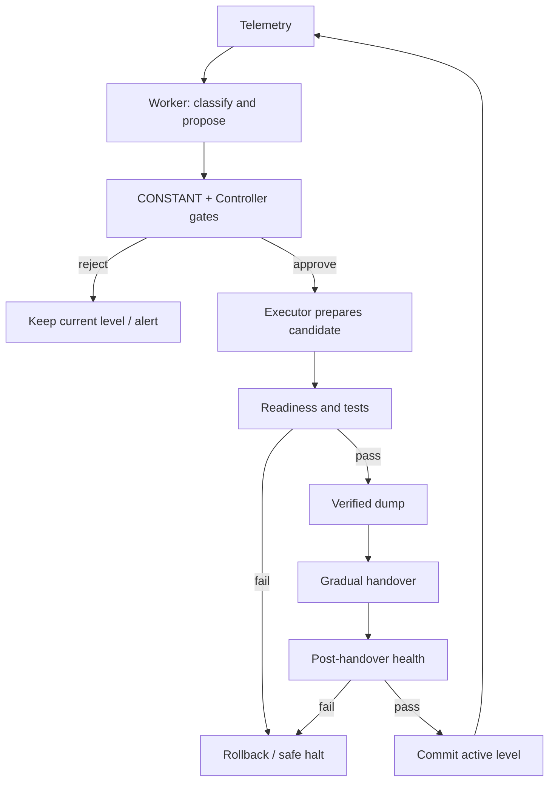

# Adaptive Controller Workflow

## Continuous control loop

1. **Observe** — collect CPU, memory, event-loop/process health, queue depth, latency, error rate, restart count, disk headroom, and application-specific metrics.
2. **Normalize** — reject stale, missing, or malformed samples. Mark telemetry confidence.
3. **Classify** — detect normal load, rising load, overload, degradation, process failure, or recovery.
4. **Plan** — WORKER ranks candidate levels/strategies using health, capacity headroom, transition cost, and recent stability.
5. **Constrain** — CONSTANT and ADAPTIVE CONTROLLER reject unsafe plans.
6. **Prepare** — EXECUTOR starts or warms only the required standby process within a temporary resource budget.
7. **Verify** — readiness checks and level-specific tests must pass.
8. **Checkpoint** — DUMP creates and verifies a checkpoint before a risky handover.
9. **Handover** — move work gradually; keep the previous process available during the observation window if resources permit.
10. **Commit or rollback** — commit the new active level only after post-handover health checks; otherwise restore the last-known-good level.
11. **Learn** — NEURO records outcome metrics; WORKER may use them for future proposals but cannot rewrite safety policy.

## Trigger policy

| Signal | Immediate action | Follow-up |
|---|---|---|
| CPU or memory approaches hard limit | Throttle admission / shed optional work | Evaluate lower-cost profile |
| Error rate or latency breaches limit | Freeze promotion; inspect active level | Roll back if health gate fails |
| Active process exits | Mark level unhealthy; acquire transition lock | Activate last-known-good profile |
| Sudden capacity increase | Keep current level until candidate is prepared | Promote only after readiness tests |
| Telemetry becomes stale | Do not promote | Use conservative profile and alert |
| Recovery succeeds | Keep recovered level under observation | Promote only after stable window |

## Transition protocol

Each transition is idempotent and has a unique `transition_id`:
`REQUESTED -> VALIDATED -> PREPARING -> READY -> HANDING_OVER -> VERIFYING -> COMMITTED`

Failure path:
`FAILED -> ROLLING_BACK -> ROLLBACK_VERIFIED`

If rollback cannot be verified:
`SAFE_HALT`

Retries are bounded. Repeating a failed transition requires a new telemetry snapshot and a cooldown.

## Test workflow

- Unit tests: policy validation, hysteresis, transition limits, stale telemetry, lock ownership.
- Simulation tests: gradual ramp, sudden spike, sudden drop, noisy signal, process crash, failed readiness, failed rollback.
- Integration tests: PM2 adapter in an isolated test environment; no production PM2 socket.
- Acceptance: no overlapping active owners, no transition without a valid checkpoint where required, bounded resource use, and successful recovery to last-known-good.
- Deployment: staging first; production requires explicit approval and a verified rollback path.

## Workflow graph

